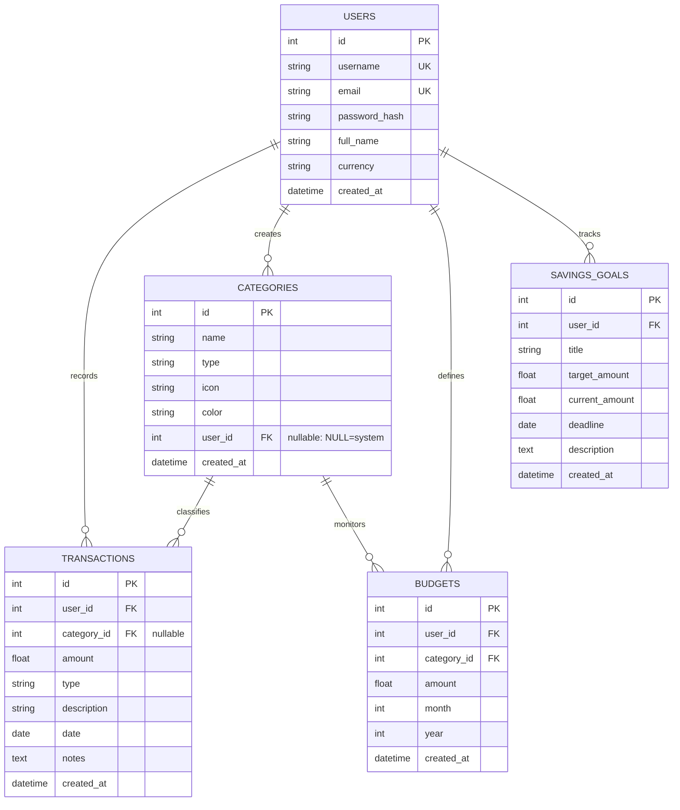

# Database Design Document
## MoneyTrack – Personal Expense & Budget Management System

> **Document Version:** 1.0  
> **Database:** SQLite 3 / Relational ORM  
> **Normalization:** Third Normal Form (3NF)  
> **Date:** November 2026  

---

## 1. Entity-Relationship (ER) Diagram

---

## 2. Table Data Dictionaries

### 2.1 `users` Table
Stores authenticated user credentials and preferences.

| Column | Data Type | Constraints | Description |
|---|---|---|---|
| `id` | INTEGER | PRIMARY KEY, AUTOINCREMENT | Unique user identifier |
| `username` | VARCHAR(80) | NOT NULL, UNIQUE | User login name (min 3 chars) |
| `email` | VARCHAR(120) | NOT NULL, UNIQUE | User primary email address |
| `password_hash` | VARCHAR(256) | NOT NULL | PBKDF2-SHA256 salted password hash |
| `full_name` | VARCHAR(150) | NULLABLE | Display name |
| `currency` | VARCHAR(10) | NOT NULL, DEFAULT 'INR' | Active currency code |
| `created_at` | DATETIME | DEFAULT UTC_TIMESTAMP | Account creation timestamp |

### 2.2 `categories` Table
Categorizes financial entries. System categories have `user_id = NULL`.

| Column | Data Type | Constraints | Description |
|---|---|---|---|
| `id` | INTEGER | PRIMARY KEY, AUTOINCREMENT | Category ID |
| `name` | VARCHAR(100) | NOT NULL | Category display label |
| `type` | VARCHAR(10) | NOT NULL | 'income' or 'expense' |
| `icon` | VARCHAR(10) | DEFAULT '📂' | Emoji icon identifier |
| `color` | VARCHAR(20) | DEFAULT '#6c757d' | Hex display color code |
| `user_id` | INTEGER | FOREIGN KEY (`users.id`), NULLABLE | NULL = System, int = User custom |
| `created_at` | DATETIME | DEFAULT UTC_TIMESTAMP | Creation timestamp |

### 2.3 `transactions` Table
Logs financial transactions.

| Column | Data Type | Constraints | Description |
|---|---|---|---|
| `id` | INTEGER | PRIMARY KEY, AUTOINCREMENT | Transaction ID |
| `user_id` | INTEGER | FOREIGN KEY (`users.id`), NOT NULL | Owner user ID |
| `category_id` | INTEGER | FOREIGN KEY (`categories.id`), NULLABLE | Associated category |
| `amount` | FLOAT | NOT NULL | Positive numeric currency amount |
| `type` | VARCHAR(10) | NOT NULL | 'income' or 'expense' |
| `description` | VARCHAR(255) | NOT NULL | Short summary of entry |
| `date` | DATE | NOT NULL | Transaction date |
| `notes` | TEXT | NULLABLE | Detailed remarks |
| `created_at` | DATETIME | DEFAULT UTC_TIMESTAMP | Record insertion timestamp |

### 2.4 `budgets` Table
Defines category spending limits for specific months.

| Column | Data Type | Constraints | Description |
|---|---|---|---|
| `id` | INTEGER | PRIMARY KEY, AUTOINCREMENT | Budget ID |
| `user_id` | INTEGER | FOREIGN KEY (`users.id`), NOT NULL | Owner user ID |
| `category_id` | INTEGER | FOREIGN KEY (`categories.id`), NOT NULL | Budgeted expense category |
| `amount` | FLOAT | NOT NULL | Budget cap amount |
| `month` | INTEGER | NOT NULL (1 - 12) | Target calendar month |
| `year` | INTEGER | NOT NULL (4 digits) | Target calendar year |
| `created_at` | DATETIME | DEFAULT UTC_TIMESTAMP | Creation timestamp |

### 2.5 `savings_goals` Table
Tracks long-term milestone financial targets.

| Column | Data Type | Constraints | Description |
|---|---|---|---|
| `id` | INTEGER | PRIMARY KEY, AUTOINCREMENT | Goal ID |
| `user_id` | INTEGER | FOREIGN KEY (`users.id`), NOT NULL | Owner user ID |
| `title` | VARCHAR(200) | NOT NULL | Target goal description |
| `target_amount` | FLOAT | NOT NULL | Target amount to save |
| `current_amount` | FLOAT | NOT NULL, DEFAULT 0.0 | Funds accumulated so far |
| `deadline` | DATE | NULLABLE | Milestone completion target date |
| `description` | TEXT | NULLABLE | Goal motivation remarks |
| `created_at` | DATETIME | DEFAULT UTC_TIMESTAMP | Creation timestamp |

