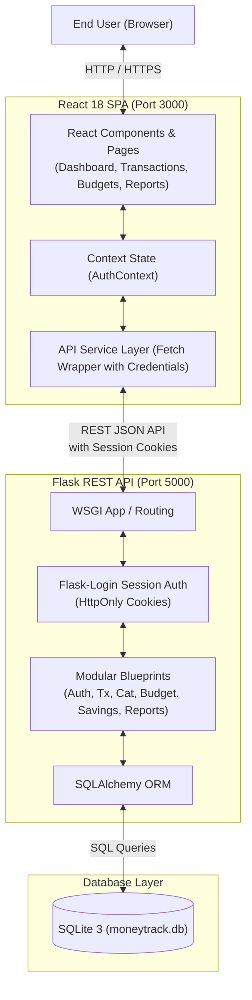

# System Architecture Document
## MoneyTrack – Personal Expense & Budget Management System

> **Document Version:** 1.0  
> **Standard:** IEEE 1471 / ISO/IEC 42010 Architecture Description  
> **Date:** November 2026  
> **Project Type:** MCA Mini Project  
> **Status:** Approved  

---

## 1. Architectural Overview

MoneyTrack is designed using a modern decoupled **Client-Server Single Page Application (SPA)** architecture. It separates concerns between the dynamic user presentation layer and the RESTful business logic and persistence layer.

---

## 2. Component Architecture

### 2.1 Frontend Architecture (React)
- **Router Layer:** `react-router-dom` v6 managing `PublicRoute` (`/login`, `/register`) and `ProtectedRoute` (`/dashboard`, `/transactions`, etc.).
- **Global Context:** `AuthContext` provides authentication status (`currentUser`, `login()`, `logout()`, `register()`).
- **Layout System:** Responsive `Sidebar`, `Topbar`, and collapsible navigation shell.
- **Service Layer:** `api.js` provides centralized, credentialed fetch calls with uniform error propagation.
- **Visualization:** `recharts` for dynamic data rendering (Pie charts, Bar charts).

### 2.2 Backend Architecture (Flask)
- **Application Factory:** `create_app()` dynamically constructs and configures the Flask application.
- **Blueprint Modularity:**
  - `auth_bp`: User registration, login, logout, profile update, password change.
  - `transactions_bp`: CRUD operations with multi-parameter filtering.
  - `categories_bp`: System default & custom category management.
  - `budgets_bp`: Monthly limits and on-the-fly spending calculations.
  - `savings_bp`: Goal milestones and incremental deposit tracking.
  - `reports_bp`: Aggregate analytical and trend queries.
- **ORM & Data Layer:** Flask-SQLAlchemy with declarative base models and relational cascades.

---

## 3. Security Architecture
- **Authentication:** Werkzeug PBKDF2-SHA256 password hashing.
- **Session Security:** Flask-Login session cookies with `SameSite=Lax` and cross-origin credential sharing via Flask-CORS.
- **Data Isolation:** User ID is strictly validated from `current_user.id` on every protected endpoint, preventing cross-tenant data leakage (IDOR).

