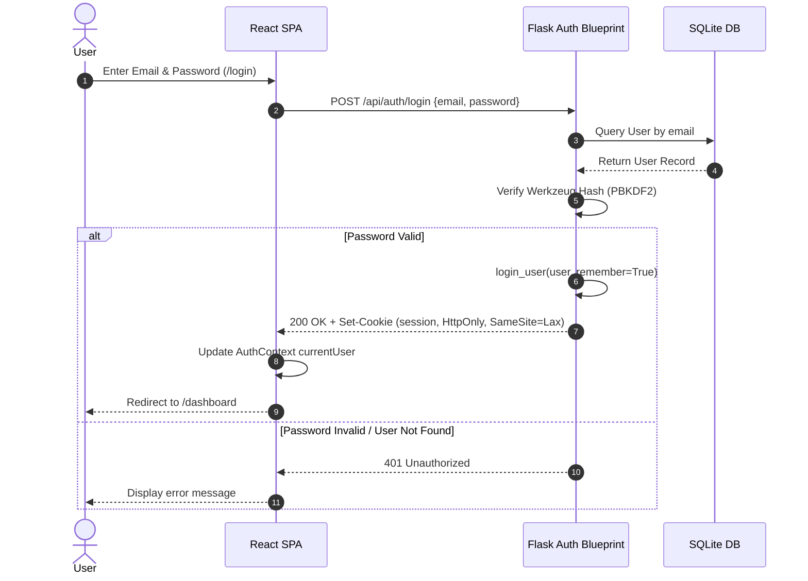
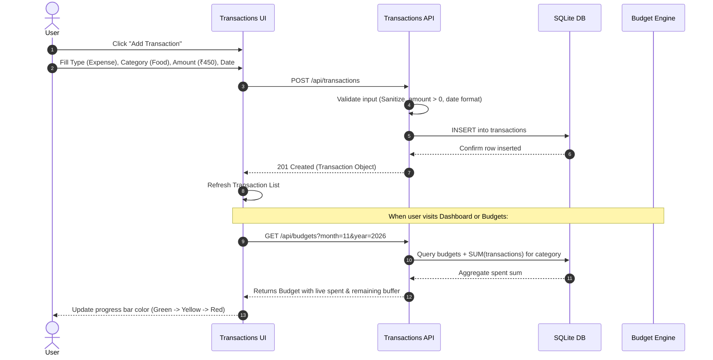
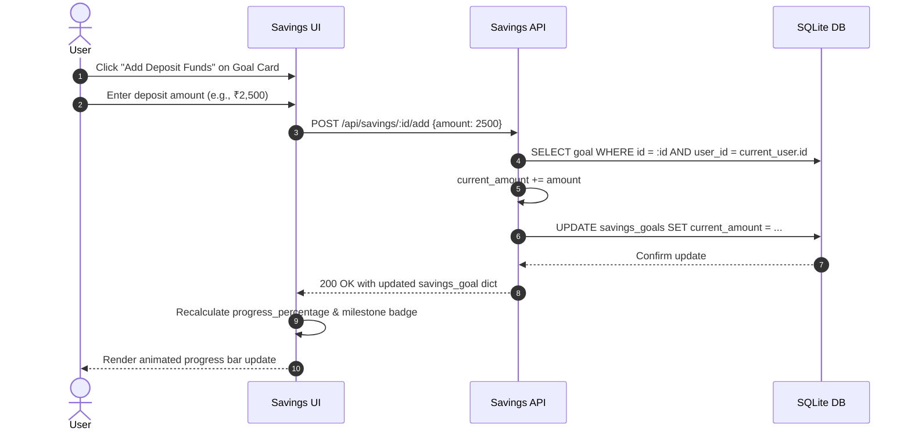

# Application Workflows & User Journeys
## MoneyTrack – Personal Expense & Budget Management System

> **Document Version:** 1.0  
> **Date:** November 2026  
> **Project Type:** MCA Mini Project  

---

## 1. User Authentication & Session Workflow

---

## 2. Transaction Entry & Budget Impact Workflow

---

## 3. Savings Goal Deposit Lifecycle

---

## 4. Analytical Reporting Workflow

1. **Dashboard Initialization:** User logs into MoneyTrack; the Dashboard simultaneously dispatches parallel asynchronous fetch requests to:
   - `/api/reports/summary` (Income, Expense, Balance)
   - `/api/reports/monthly` (Last 12-month trend)
   - `/api/reports/category` (Current month expense distribution)
   - `/api/transactions?limit=5` (Recent 5 transactions)
2. **Data Transformation & Chart Rendering:**
   - React processes categorical aggregates into Recharts `<PieChart>` with assigned color schemes.
   - Monthly cash flows are rendered as `<BarChart>` comparing side-by-side Income vs. Expense metrics.

